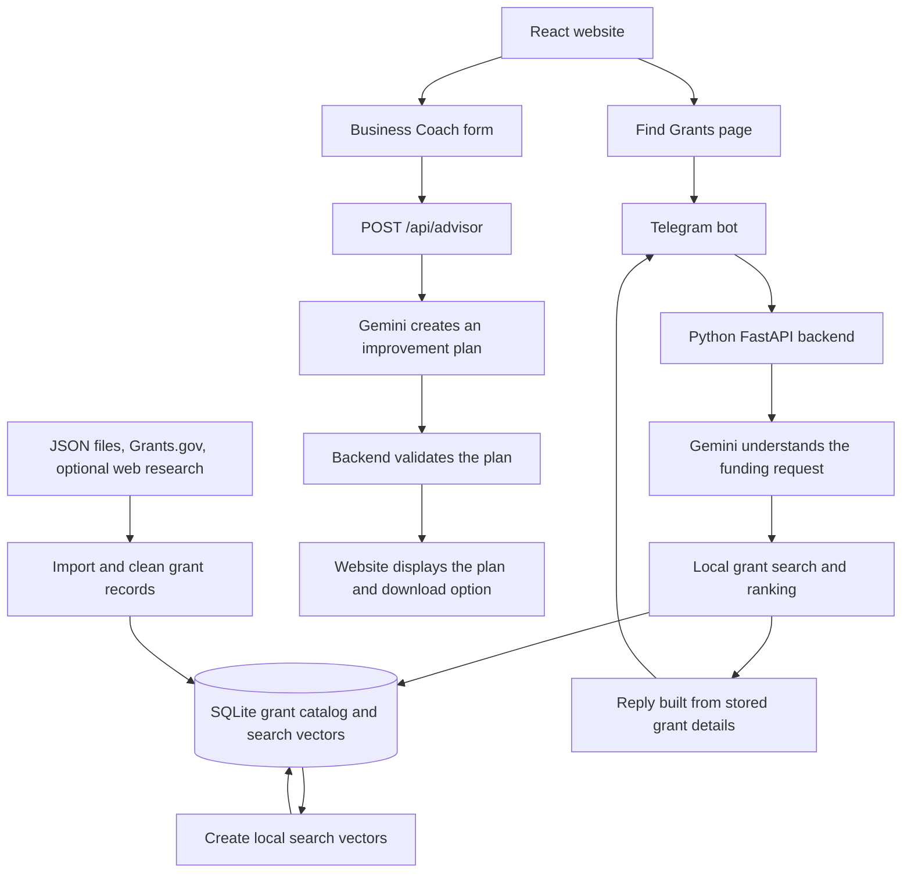

# CivicText: complete project guide

This guide describes the code currently in this repository. It explains the purpose of the project, how each feature works, and how the parts connect. Examples illustrate the process; they are not promises of funding or business results.

## 1. Why this project exists

CivicText has two connected goals:

1. **Help small businesses and community projects find grants.** Grant information is scattered across websites, eligibility rules can be difficult to understand, and searching takes time. CivicText lets someone describe a need in everyday language and find relevant opportunities from a collected catalog.
2. **Help businesses improve how they operate and sell.** Funding alone does not solve every problem. Owners also need practical ideas for marketing, sales, repeat customers, and everyday operations. Business Coach turns their situation into manageable next steps.

The intended users include small-business owners, entrepreneurs, artists, farmers, nonprofits, and community organizers. The current grant system mainly works with United States opportunities, state codes, and dollar amounts.

The main idea is: **find funding, then put practical improvements into action.** Neither feature requires a website account in the current application. Grant discovery is the first focus of the homepage, with business improvement presented alongside it.

The service helps people discover and assess opportunities. It does not award money, submit grant applications, or guarantee eligibility. Business advice is a starting point for experiments, not a guarantee of increased sales.

## 2. The whole system at a glance

There are two user journeys and a separate process for preparing grant data:



The grant finder searches stored opportunities. Business Coach generates suggestions from the information the owner provides. They share the website, Python service, and Google Gemini provider, but they do not automatically pass profiles or results to each other.

## 3. What each technology does

| Part | Technology | Simple explanation |
| --- | --- | --- |
| Website | React and TypeScript | Displays pages, forms, links, filters, and results. TypeScript helps catch mistakes in the data used by the website. |
| Development and build | Vite | Runs the local website and produces the production files. |
| Page navigation | React Router | Selects the page for addresses such as `/grants` and `/business-coach`. |
| Styling | CSS and CSS Modules | Controls the layout, colors, responsive behavior, and animations. |
| Backend | Python and FastAPI | Receives website requests, communicates with Telegram and Gemini, and runs grant processing. |
| Data validation | Pydantic | Checks that requests and AI responses have the expected fields and valid values. |
| AI provider | Google Gemini | Understands funding requests, generates business plans, and supports optional web research. |
| Grant AI integration | LangChain with Google's Gemini integration | Requests structured information from a user's funding message and supports configured fallback models. |
| Web research integration | Google GenAI SDK | Runs Google Search grounding and extracts researched grant records. |
| Business Coach integration | Gemini REST API through HTTPX | Sends the business profile to Gemini from the server. |
| Database | SQLite | Stores grant records, their search vectors, and unmatched-request subscriptions in a local file. |
| Meaning-based search | FastEmbed and NumPy | Converts text into number lists and compares them locally. |
| Messaging | Telegram Bot API | Receives messages and sends grant replies to users. |

## 4. The website, page by page

| Address | What the visitor does | How it connects |
| --- | --- | --- |
| `/` | Chooses grant discovery or business improvement. | Links to both features and explains their separate workflows. |
| `/demo` | Reads about the grant finder and opens Telegram using a link or QR code. | Opens the configured bot, currently `@CivicS123_bot`. Despite the route name, this page is a Telegram entry point. |
| `/grants` | Browses fictional sample grant listings and changes filters. | Uses bundled frontend data, not the Python grant database. |
| `/business-coach` | Describes a business and requests an improvement plan. | Calls the Python `/api/advisor` endpoint. |
| `/stories` | Reads illustrative community scenarios. | Uses fictional story data rather than verified customer outcomes. |
| `/dashboard` | A developer watches incoming Telegram requests locally. | Connects to the backend's `/stream` event feed. |
| Any unknown address | Sees a page-not-found message. | Handled by the final React Router route. |

The shared navigation, footer, and layout connect these pages. The homepage improvement cards also pass a goal in the URL, such as `/business-coach?goal=More%20sales`, so the matching goal is selected when the coach opens.

## 5. How the grant catalog is prepared

The bot needs a searchable collection of grant records before it can return useful matches. This preparation is done by command-line tools; starting the server does not automatically collect and index all grants.

### Step 1: Collect grant information

The project supports these sources:

| Source | Location or importer | What it contains |
| --- | --- | --- |
| Curated records | `backend/data/seed_grants.json` | Hand-prepared records, including samples where labeled. |
| Third-party listings | `backend/data/listed_grants.json` | Listings that need independent checking. |
| Saved web research | `backend/data/web_grants.json` | Previously researched grant records with source notes. |
| Federal grants | `grantfinder/ingest/grants_gov.py` and `grants_gov_bulk.py` | Grants.gov keyword results or its downloadable XML extract. |
| New web research | `grantfinder/ingest/web_search.py` | Opportunities found through Gemini with Google Search grounding. |

At the time this guide was written, the bundled backend JSON files contained **38 curated records, 84 third-party listings, and 30 web-research records**. These are file counts, not counts of verified, currently open grants or records already loaded into the local database.

### Step 2: Convert different sources into one format

Each importer produces a common `Grant` record with fields such as name, funder, description, amount, deadline, eligibility, location, category, and application URL.

This is what lets a federal grant and a locally researched grant go through the same search process.

### Step 3: Store and update records

The database lives at `backend/data/grants.db`. `grantfinder/db.py` creates the tables and inserts records.

Each grant has a source-based ID. A hash of its important fields acts like a fingerprint: new records are added, changed records are updated, and unchanged records are skipped. Repeated imports can refresh the catalog without adding the same source record again.

### Step 4: Build the meaning-based search index

`grantfinder/retrieval.py` combines the grant's descriptive text and uses the local `BAAI/bge-small-en-v1.5` embedding model to turn it into a list of numbers, called a vector. Similar descriptions tend to produce similar vectors.

These vectors are stored in SQLite alongside the grant IDs and content hashes. Indexing creates or refreshes vectors for eligible records that are new, changed, or use a different embedding model. The first run may download the embedding model; later searches run locally.

Importing and indexing are separate steps. A record added to the database needs a search vector before the bot's semantic search can retrieve it.

### Optional path: discovering new grants on the web

Web ingestion makes two logical Gemini calls for each search topic:

1. A Google-grounded call researches grant programs and returns a write-up with source information.
2. A structured-output call turns that write-up into grant fields.

Python then cleans the fields, removes records with known past deadlines, checks URLs, drops links returning 404 or 410, and deduplicates by a normalized URL. Successful records are saved with source `web` and can then be indexed.

The saved research file includes labels such as `official-page`, `multiple-sources`, and `aggregator-only`. Newly generated records carry research metadata; the importer does not automatically establish official verification. A reachable link also does not prove eligibility or availability.

**This web search is an explicit data-preparation command. The Telegram bot does not run a fresh web search for every message.** `--source all` does not trigger new web research; that requires `--source web` and uses API quota.

## 6. How a Telegram grant request works

Example message:

> I run a bakery in Georgia and need $5,000 to buy an oven. Are there any grants?

### Step 1: Receive the message

When `TELEGRAM_TOKEN` is configured, `backend/main.py` loads the local embedding model and starts a background polling task. Polling means the backend repeatedly asks Telegram for new messages. The startup task deletes the bot's existing webhook so Telegram will allow polling.

The code also retains `POST /webhook` for receiving pushed updates. However, the current default startup behavior is polling. A webhook deployment would need an explicit mode change so startup does not delete its registration.

Recent update IDs are remembered in memory to reduce duplicate replies. Incoming messages are also broadcast to connected local dashboard viewers.

### Step 2: Decide what the user is asking

`grantfinder/answer.py` handles simple greetings directly, without an AI request. Other messages go to `grantfinder/understand.py`.

Gemini extracts structured fields such as:

```text
Intent: grant search
Business: bakery
Need: oven
State: GA
Amount: 5000
Search description: funding for bakery equipment in Georgia
```

Python normalizes values, such as changing a state name to its two-letter code and removing invalid amounts. The parser uses information in the message rather than assuming personal characteristics from a name.

Off-topic requests are redirected to grant discovery. Vague requests receive a question asking for more useful details.

### Step 3: Find and rank relevant grants

The search combines meaning and keywords:

1. Read indexed grants that are not closed and do not have known expired deadlines.
2. If a state is supplied, keep nationwide grants and grants for that state.
3. Compare the request's vector with grant vectors to find similar descriptions.
4. Require overlap with specific words from the user's need, reducing unrelated results.
5. Apply a basic applicant-eligibility screen for federal records.
6. Add small ranking bonuses for relevant keywords, location, and grants that may cover the requested amount.
7. Keep matches above the configured relevance threshold.

This is relevance screening, not a complete eligibility decision. Forecasted opportunities may appear and are marked as not open yet.

### Step 4: Build the reply from stored information

The best match is formatted with the title, funder, amount, deadline, description, eligibility when available, and application or information link. Up to two additional matches can be listed.

Gemini interprets the request, but the final grant facts come from stored records. This reduces the risk of an AI inventing an award amount or application deadline. The records themselves still need checking against the funder's page.

`backend/main.py` sends the reply through Telegram's `sendMessage` API. Blocking grant processing runs in a worker thread so the Python event loop can continue handling other work.

### Step 5: Handle no matches

If there is no suitable result and a chat ID is available, the backend can save the request in the `subscriptions` table and return fallback information.

**Automatic future notifications are not implemented.** The current reply says the user will be contacted if a grant is added, but only the request-saving part exists. A matching and notification worker is still needed to fulfill that promise.

## 7. How Business Coach works

### Step 1: Collect the business profile

The owner opens `/business-coach` and enters the business description, customers, main goal, and optional business name, location, monthly growth budget, current marketing channels, and challenges.

Goals include more sales, better marketing, repeat customers, smoother operations, and overall growth. The example-details button fills a sample profile; it does not generate an AI response by itself.

### Step 2: Send the profile to the backend

`src/lib/businessCoach.ts` sends the profile as JSON to `POST /api/advisor`. The browser does not receive or send the Gemini secret key.

In development, Vite forwards `/api` requests to the Python server. This connects the website on port 5173 to the backend on port 8000.

### Step 3: Validate the input

`backend/business_advisor.py` checks the profile using Pydantic. Required descriptions cannot be empty, the goal must be supported, text lengths are limited, and the budget cannot be negative.

Invalid inputs are rejected before a Gemini generation request is made.

### Step 4: Ask Gemini for a practical plan

The backend sends the profile with instructions to prioritize the selected goal, suggest practical steps, respect the total monthly budget, favor free experiments, avoid invented business facts, and state assumptions where information is missing.

It requests a structured JSON response. The configured default model is `gemini-3.5-flash-lite`, with an optional `ADVISOR_MODEL` override. One submission makes one bounded generation request, without automatic retries or fallback-model calls in this feature.

Business Coach does not search the grant database or browse live business information. Its advice is based on the supplied profile and the model's knowledge.

### Step 5: Validate and display the result

The backend rejects incomplete, blocked, malformed, or invalid responses. A valid plan contains:

- A short overview and a quick win to start today.
- Three or four recommendations with reasons, steps, estimated costs, and metrics.
- Four weekly actions, ordered from week 1 through week 4.
- A marketing caption and call to action to review and edit.
- Assumptions and useful follow-up questions.

The website displays these sections and supports copying the caption or downloading the plan as text. Follow-up questions are suggestions to explore; the page is currently a form-to-plan experience, not a continuing chat conversation.

Plans and profiles are not saved to an application database. They remain in page state until navigation or refresh, unless the owner downloads a copy.

### Step 6: Show understandable errors

The interface handles missing configuration, invalid input, usage limits, unavailable services, timeouts, and incomplete responses. Failed requests leave the entered profile available for correction or retry.

The `/api/advisor/status` endpoint reports whether a key is present. It does not prove the key is valid or that quota is available; a successful generation is the stronger check.

## 8. How the features integrate

| Connection | What is shared | What remains separate |
| --- | --- | --- |
| Website and Telegram | The site directs visitors to the grant bot. | Grant conversations happen in Telegram, not in the website form. |
| Grant finder and Business Coach | Both support the same business owner and use the Python service and Gemini provider. | The bot retrieves stored opportunities; the coach creates improvement suggestions. |
| Business Coach and grant data | A user can use a plan to decide what funding to look for. | There is no automatic coach-to-grant search or shared profile yet. |
| Backend and dashboard | Incoming Telegram events are streamed to local viewers. | The dashboard is a development monitor, not a user account or production analytics system. |
| Website samples and backend grants | Both demonstrate grant discovery concepts. | Their records, filtering rules, and storage are separate. |

For example, a bakery owner can ask the bot for equipment grants and use Business Coach to explore ways to improve weekday orders. The owner currently connects those two activities themselves; the application does not automatically merge the grant results into the business plan.

## 9. What the sample grant page does

`/grants` uses fictional TypeScript records in `src/data/`. Filtering runs entirely in the browser through `src/lib/grantSearch.ts`.

Visitors can filter by keyword, organization type, audience, focus area, state, and grant size, then sort by match, deadline, or amount. Filter selections are saved in the URL so a view can be shared or bookmarked.

**Importing 30 new grants into SQLite does not add them to this page.** A real catalog endpoint and frontend integration would be needed to display the backend's records on the website.

## 10. What is stored, and where

| Information | Location | Purpose |
| --- | --- | --- |
| Bundled sample listings and stories | `src/data/` | Website demonstrations. |
| Importable grant records | `backend/data/*.json` | Starting data and saved research. |
| Imported grants | SQLite `grants` table | Searchable catalog. |
| Meaning-based search vectors | SQLite `embeddings` table | Local semantic retrieval. |
| Unmatched funding requests | SQLite `subscriptions` table | Records for a future notification feature. |
| Recent Telegram update IDs | Server memory | Duplicate-message handling during that process's lifetime. |
| Dashboard subscribers | Server memory | Live event delivery to connected viewers. |
| Business Coach form and plan | Browser page state | Current interaction; optional user-controlled text download. |
| API keys and bot token | `backend/.env` locally, server environment when hosted | Credentials used only by the backend. |

## 11. Local setup and everyday use

### A. Install the website dependencies

From the repository root:

```bash
npm ci
npm run dev
```

Open `http://localhost:5173`. Leave this process running while using the local site.

### B. Install the backend dependencies

For the complete grant finder and Business Coach:

```bash
python3 -m venv backend/.venv
backend/.venv/bin/python -m pip install -r backend/requirements.txt
```

For Business Coach alone, use `backend/requirements-advisor.txt` instead. This avoids the grant-search dependencies and embedding model setup. The commands here use the macOS/Linux virtual-environment paths.

### C. Configure the credentials

If `backend/.env` does not exist, create it from `backend/.env.example`. If it already exists, edit it without replacing your saved values.

```dotenv
GEMINI_API_KEY=YOUR_GEMINI_KEY
LLM_API_KEY=YOUR_GEMINI_KEY
TELEGRAM_TOKEN=YOUR_TELEGRAM_BOT_TOKEN
ADVISOR_MODEL=gemini-3.5-flash-lite
```

| Variable | Used by |
| --- | --- |
| `GEMINI_API_KEY` | Business Coach. |
| `LLM_API_KEY` | Grant request understanding and optional web ingestion. Also accepted by Business Coach if `GEMINI_API_KEY` is empty. |
| `TELEGRAM_TOKEN` | Telegram polling and reply delivery. Leave empty for coach-only use. |
| `ADVISOR_MODEL` | Optional coach model selection. |
| `LLM_MODEL` / `LLM_FALLBACK_MODELS` | Optional grant-system model selection and fallbacks. |
| `VITE_BACKEND_URL` in the root website configuration | Vite's local API proxy target and the local dashboard's backend address. Defaults to `http://127.0.0.1:8000`. |

The same Gemini key can be assigned to both key variables. The fallback is one-way: setting only `GEMINI_API_KEY` does not configure the grant system's `LLM_API_KEY` lookup.

The key values shown above are placeholders. Real keys belong in the ignored `.env` file, not in frontend source, `VITE_` variables, screenshots, or committed examples. Restart the backend after changing its `.env`; a running process keeps the configuration it loaded earlier.

Google controls model access, free-tier eligibility, quotas, and any billing. The application does not force an account to use a free tier. New grounded web research is a separate source of API usage from generating coach plans.

### D. Prepare the grant database

From `backend/`, with the full dependencies installed:

```bash
.venv/bin/python -m grantfinder.cli ingest --source seed
.venv/bin/python -m grantfinder.cli index
.venv/bin/python -m grantfinder.cli stats
```

The `seed` command loads the available curated, listing, and saved web-research JSON files. Optional commands are:

```bash
# Import Grants.gov data too; the bulk download can be substantial.
.venv/bin/python -m grantfinder.cli ingest --source all

# Perform new web research using API quota.
.venv/bin/python -m grantfinder.cli ingest --source web --query "grants for food businesses in Georgia"

# Refresh search vectors after either import.
.venv/bin/python -m grantfinder.cli index
```

These are manual preparation and refresh commands. There is currently no scheduled catalog refresh worker.

### E. Start the backend

From the repository root, in a second terminal:

```bash
backend/.venv/bin/python -m uvicorn main:app --app-dir backend --host 127.0.0.1 --port 8000
```

With no Telegram token, the website API starts independently. With a token, the server loads embeddings and starts polling Telegram. Keep one polling instance for a bot token to avoid competing consumers.

### F. Try both features

For the grant bot, send: “I run a bakery in Georgia and need $5,000 for an oven.” A useful response depends on credentials, available quota, the imported catalog, and completed indexing.

For Business Coach, describe the bakery, its customers, a $100 monthly budget, a goal of more sales, and quiet weekdays as the challenge. Submit the form and check for a complete four-week plan.

A response saying “not connected yet” means the running backend does not see a coach key. Check the correct `.env` file and restart the backend. A usage-limit message is a different problem: the provider has rejected a request because of quota or capacity limits.

## 12. Main files to understand

| File or folder | Responsibility |
| --- | --- |
| `src/main.tsx` and `src/App.tsx` | Start React and define the website routes. |
| `src/components/Hero.tsx`, `BusinessTools.tsx`, `HowItWorks.tsx` | Present the two project goals and entry points. |
| `src/pages/Demo.tsx` | Telegram link, QR code, and grant-finder introduction. |
| `src/pages/BusinessCoach.tsx` | Business form, loading and error states, results, caption copying, and downloads. |
| `src/lib/businessCoach.ts` | Frontend request types, API call, sample profile, and text export. |
| `src/pages/Grants.tsx` and `src/lib/grantSearch.ts` | Browser-side sample grant filtering. |
| `src/pages/Dashboard.tsx` | Local incoming-message monitor. |
| `src/lib/platform.ts` | Bot URL and dashboard backend configuration. |
| `vite.config.ts` | Local website setup and `/api` forwarding. |
| `backend/main.py` | FastAPI startup, Telegram polling/webhook handling, replies, event stream, and advisor routing. |
| `backend/business_advisor.py` | Validates business profiles, calls Gemini, and validates growth plans. |
| `backend/grantfinder/understand.py` | Converts grant messages into structured requests. |
| `backend/grantfinder/retrieval.py` | Creates vectors and ranks stored grants. |
| `backend/grantfinder/answer.py` | Handles intent, formats results, and saves unmatched requests. |
| `backend/grantfinder/db.py` and `models.py` | Define grant records and database storage. |
| `backend/grantfinder/ingest/` | Imports JSON files, Grants.gov records, and web research. |
| `backend/grantfinder/llm.py` | Configures grant-model clients, fallbacks, and local embeddings. |
| `backend/grantfinder/cli.py` | Operator commands for ingestion, indexing, searching, and diagnostics. |
| `backend/tests/` | Automated tests and retrieval evaluation examples. |
| `vercel.json` | Declares separate frontend and backend services and request routing. |

The repository also contains older authentication, local conversation, and application-draft helper code. Those files are not connected as active sign-in or grant-chat routes in `src/App.tsx`. Their presence does not mean those features are currently available to visitors.

## 13. Checks and testing

From the repository root:

```bash
npm run build
npm run lint
```

The build checks TypeScript and creates the production website. Lint checks source rules.

For the lightweight advisor and Telegram transport tests, run from `backend/` with pytest installed:

```bash
.venv/bin/python -m pytest tests/test_business_advisor.py tests/test_telegram.py -q
```

With full backend dependencies installed, the broader tests can be run without the explicitly named live extraction cases:

```bash
.venv/bin/python -m pytest tests -q -k "not live"
```

Tests cover areas such as input validation, provider errors, structured output, duplicate messages, grant formatting, import cleaning, ranking, and web-research record handling. They use fake providers or test data where appropriate. Live extraction tests and evaluation commands are separate checks that can make real API calls.

Passing tests does not prove every stored grant is current, a live bot is deployed, or Google will accept every future request.

## 14. Deployment and current boundaries

`npm run build` produces the website in `dist/`. Browser routes need an `index.html` fallback on the hosting platform.

The repository's Vercel configuration declares a Vite frontend service and a FastAPI backend service. `/api/*` requests go to the backend; other website paths go to the frontend. Hosted credentials must be set in the server environment.

There are additional requirements for hosting the complete grant system:

- SQLite needs a persistent, writable location, or a hosted database replacement. A temporary deployment filesystem is not a durable catalog.
- Telegram polling needs a continuously running process. Do not assume a request-based or serverless deployment will keep the polling loop alive.
- A webhook-based deployment needs a reachable backend route, Telegram registration, and a startup mode that leaves the webhook in place. The existing frontend `/api/*` rewrite does not by itself expose `/webhook` or `/stream` at those paths.
- The advisor endpoint and event stream do not currently have user authentication or a shared rate limiter. The website restricts the monitor to local development, but the backend stream itself has no authentication.
- Catalog refreshes, subscription notifications, durable duplicate tracking, and a website view of the real backend catalog are unfinished integration work.
- Unknown grant deadlines may be stored as null, which the current formatter can present like a rolling deadline. Confirm the actual deadline with the funder.

For development, the two main capabilities can be used separately: the coach needs Gemini configuration, while the Telegram grant finder also needs its token, grant data, and search index. Together they support the project's purpose: **help people discover funding and make practical improvements to their businesses.**
